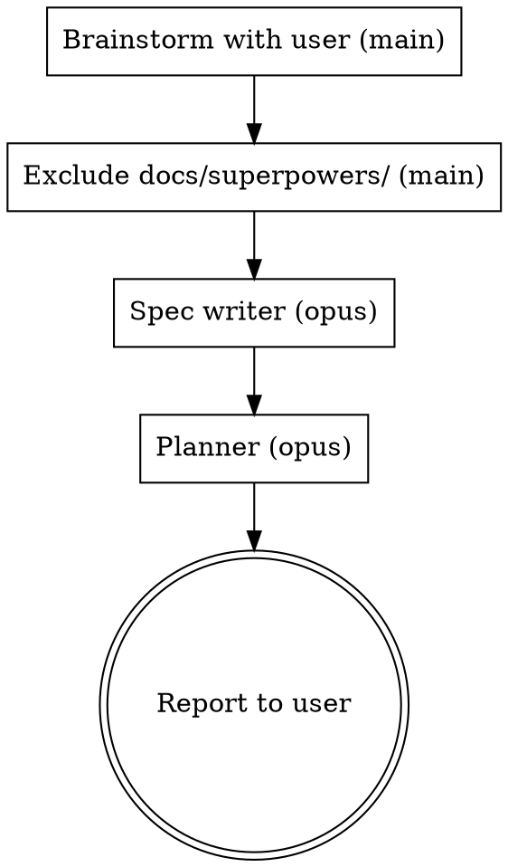

# Superpowers Planning

## Overview

Planning-only pipeline: brainstorm → spec → plan. Then **stop**. No worktree, no code,
no review loop, no PR.

The **only** human interaction is the brainstorming dialogue at the start. After the
user confirms the design, the main agent never stops to ask for approval again.

**Core principle:** The main agent is an orchestrator. The spec and the plan are each
written by a dedicated `opus` subagent. The main agent never writes the spec or the plan
itself, and nobody writes production or test code.

This skill overrides the approval gates in the reused superpowers skills:
- brainstorming's "user reviews written spec" gate → skipped (spec writer self-reviews)
- brainstorming's handoff to writing-plans → done by a planner subagent, not inline
- writing-plans' "Execution Handoff" question → skipped (planner records a recommendation,
  nothing is executed)
- brainstorming's and writing-plans' "commit the spec/plan" steps → **never commit** spec or
  plan files (anything under `docs/superpowers/`); they stay untracked, local-only

## Phase Map

| # | Phase | Who runs it | Model | Skill(s) used | Returns to main agent |
|---|-------|-------------|-------|---------------|-----------------------|
| 1 | Brainstorm | main agent | session | `superpowers:brainstorming` (dialogue only) | design summary |
| 1.5 | Exclude spec/plan from git | main agent | session | — | — |
| 2 | Write + self-review spec | 1 subagent | `opus` | brainstorming's spec format + `spec-document-reviewer-prompt.md` | spec path |
| 3 | Write + self-review plan | 1 subagent | `opus` | `superpowers:writing-plans` | plan path + `native`/`subagent` recommendation |
| 4 | Report | main agent | session | — | — |



## Phase 1 — Brainstorm (main agent, interactive)

1. Invoke `superpowers:brainstorming`. Follow its dialogue: explore context, ask one
   question at a time, propose approaches, present the design.
2. Keep asking until the user confirms the design covers the whole business need.
3. **Stop following brainstorming at "Write design doc".** Do not write the spec yourself.
   Even if brainstorming classifies the work as "bounded", this pipeline still produces a
   (short) written spec and plan.
4. Write a self-contained design summary (goals, scope, non-goals, decisions, constraints,
   edge cases, user-stated preferences) — the spec writer has no access to this conversation.

From here on, do not ask the user anything (see Stop Conditions).

## Phase 1.5 — Keep Spec/Plan Out of Git (main agent)

Work in the current checkout — no worktree, no new branch. Append the ignore rule to the
repo-local exclude file (never to `.gitignore`, which would itself be committed):

```bash
EXCLUDE="$(git rev-parse --path-format=absolute --git-common-dir)/info/exclude"
grep -qxF 'docs/superpowers/' "$EXCLUDE" || echo 'docs/superpowers/' >> "$EXCLUDE"
```

If the repo stores specs/plans elsewhere, exclude that location instead. Record
`REPO_PATH=$(git rev-parse --show-toplevel)`.

Include this line in every dispatch:
`Work only inside <REPO_PATH>. Write only the spec/plan file — never edit source or test files. Never commit, stage, or push anything.`

## Phase 2 — Spec (subagent, `opus`)

Dispatch with `Agent(model: "opus", subagent_type: "general-purpose")`:

```
You are writing the design spec for: <feature>.
Design summary (agreed with the user — this is the source of truth):
<design summary>

1. Read the "After the Design" section of the superpowers:brainstorming skill and write
   the spec to docs/superpowers/specs/YYYY-MM-DD-<topic>-design.md (unless the repo
   specifies another location). Do NOT commit it — ignore brainstorming's commit step.
   Do NOT continue into writing-plans or implementation.
2. Review your own spec using brainstorming's spec-document-reviewer-prompt.md checklist
   (placeholders, contradictions, ambiguity, scope, missing edge cases). Fix every issue
   and re-review until clean.
3. Do NOT ask the user to review. Reply with exactly:
   SPEC_PATH: <path>
   SUMMARY: <3-5 lines>
   OPEN_ASSUMPTIONS: <assumptions you made, or "none">
```

## Phase 3 — Plan (subagent, `opus`)

Dispatch with `Agent(model: "opus", subagent_type: "general-purpose")`:

```
Use the superpowers:writing-plans skill to write the implementation plan for the spec at
<SPEC_PATH>. Every task must follow TDD (superpowers:test-driven-development).
1. Write the plan. Do NOT commit it — ignore writing-plans' commit step.
   Every commit step/command in the plan must have a plain commit message with NO AI
   attribution: no Co-Authored-By Claude/Anthropic trailer, no "Generated with Claude Code",
   no "contributed by Anthropic/Sonnet" or similar line.
2. Run the plan self-review and review it with writing-plans' plan-document-reviewer-prompt.md.
   Fix every issue and re-review until clean.
3. SKIP the "Execution Handoff" question and do NOT start implementing. Record which
   execution mode you recommend for whoever implements it later:
   - native: tasks are tightly coupled / share evolving interfaces, or the plan is small
     (roughly ≤ 5 tasks) — one implementer keeps the whole picture.
   - subagent: tasks are mostly independent, or the plan is large enough that one context
     would degrade.
Reply with exactly:
   PLAN_PATH: <path>
   TASK_COUNT: <n>
   EXECUTION: native | subagent
   REASON: <one sentence>
```

## Phase 4 — Report (main agent)

Verify nothing leaked into git: `git status --porcelain -- docs/superpowers/` prints nothing
(excluded), and `git diff --name-only HEAD` shows no files the subagents should not have
touched. If source files changed, report it to the user — do not revert silently.

Then tell the user: spec path, plan path, task count, recommended execution mode + reason,
and any open assumptions. Mention how to proceed when they are ready:
`superpowers:subagent-driven-development` (subagent) or `superpowers:executing-plans` (native).

**Stop here.** Do not offer to start implementing, and do not start it.

## Stop Conditions

After Phase 1, the main agent asks the user **only** if a subagent reports a blocker that
makes the agreed design impossible (e.g. a required dependency does not exist). Everything
else is a ruling: decide, record it in the report, continue.

## Red Flags — You Are Breaking the Pipeline

| Thought | Reality |
|---------|---------|
| "I'll write the spec myself, I have the context" | Spec is written by an opus subagent. Pass the context in the design summary. |
| "Let me ask the user to review the spec before planning" | No approval gates after brainstorming. |
| "Plan is done, I'll just kick off implementation" | This skill ends at the plan. Report and stop. |
| "Which execution mode do you prefer?" | The planner records a recommendation. Nothing is executed. |
| "I should create a worktree first" | No worktree, no branch. Planning only. |
| "brainstorming/writing-plans say commit the doc" | Never commit spec or plan files. They stay untracked. |
| Omitting `model` on a dispatch | Both dispatches set `model: "opus"` explicitly. |
