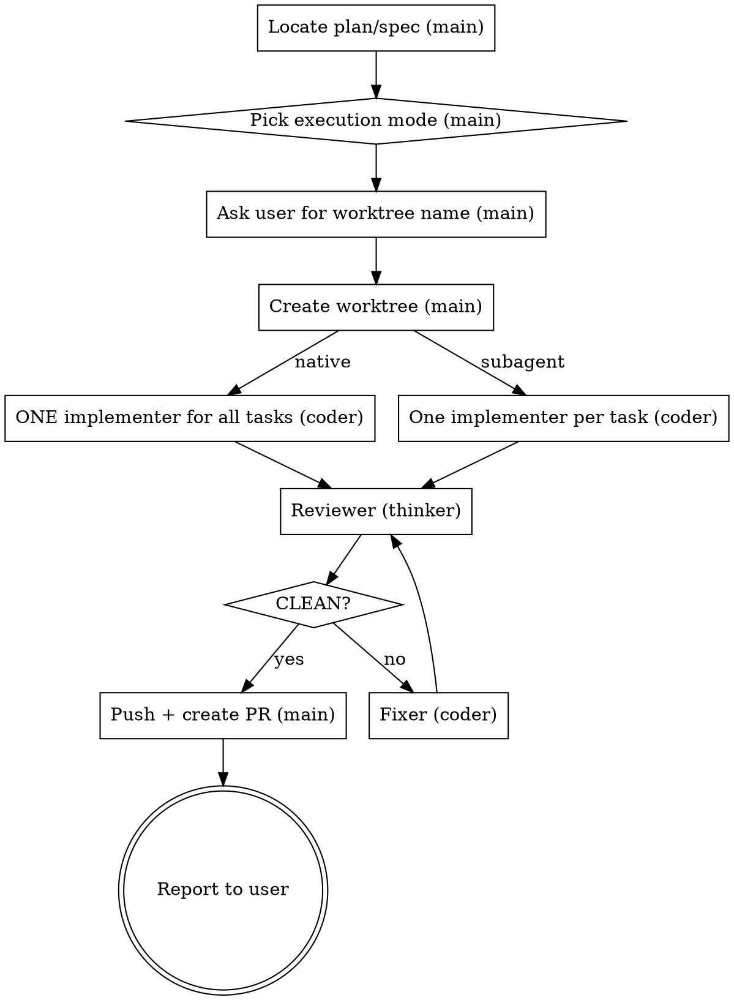

# Superpowers Implementation

## Overview

Implementation-only pipeline: worktree → implement → review/fix loop → PR. It is the back
half of `superpowers-e2e` and picks up where `superpowers-planning` stops. No brainstorming,
no spec writing, no plan writing — the plan is the source of truth.

The **only** human interaction is at the start: confirming the plan/spec and asking for the
worktree name. After that the main agent never stops to ask for approval again.

**Core principle:** The main agent is an orchestrator. Implementation, review, and fixes each
run in a dedicated subagent on a fixed model. The main agent never writes the code, the
tests, or the review itself.

This skill overrides the approval gates in the reused superpowers skills:
- executing-plans' / subagent-driven-development's "which execution mode?" → decided by the
  main agent (Phase 1, step 3)
- subagent-driven-development's per-task review → skipped (one review loop at the end)
- using-git-worktrees' "new branch / worktree / work in place?" question → always **worktree**
- finishing-a-development-branch's "merge / PR / keep / discard?" menu → always **Push and create a Pull Request**
- **never commit** spec or plan files (anything under `docs/superpowers/`); they stay
  untracked, local-only
- the harness's commit attribution → **never add AI attribution** to commits: no
  `Co-Authored-By: opencode ...`, no "Generated with opencode", no "contributed by
  GLM/DeepSeek" or any similar trailer or line

The worktree **name** is the one thing the main agent never decides: it always asks the
user (Phase 1, step 4).

## Models

| Role | Dispatch | Model | Used for |
|------|----------|-------|----------|
| thinker | `task` tool, `subagent_type: "superpowers-thinker"` | `opencode-go/glm-5.3` | review |
| coder | `task` tool, `subagent_type: "superpowers-coder"` | `opencode-go/deepseek-v4-flash` | implement, fix |

The model is pinned in the subagent definition (`~/.config/opencode/agents/superpowers-*.md`),
so a dispatch only names the subagent. Never run a pipeline phase on the built-in `general`
or `explore` subagent — they use the session model.

## Phase Map

| # | Phase | Who runs it | Model | Skill(s) used | Returns to main agent |
|---|-------|-------------|-------|---------------|-----------------------|
| 1 | Locate plan/spec, pick mode, ask worktree name | main agent | session | — | plan path, spec path, mode, worktree name |
| 1.5 | Create worktree | main agent | session | `superpowers:using-git-worktrees` | worktree path |
| 2a | Implement (native) | exactly 1 subagent | `coder` | `superpowers:executing-plans` + `superpowers:test-driven-development` | done report |
| 2b | Implement (subagent) | 1 subagent per task | `coder` | `superpowers:subagent-driven-development` (no per-task review) + TDD | done report per task |
| 3 | Review | 1 fresh subagent per round | `thinker` | `superpowers:requesting-code-review` | findings or `CLEAN` |
| 4 | Fix | 1 fresh subagent per round | `coder` | `superpowers:receiving-code-review` + TDD | fix report |
| 5 | Publish | main agent | session | `superpowers:finishing-a-development-branch` (option: push + PR) | PR URL |

Phases 3 ↔ 4 repeat until the reviewer returns `CLEAN`.



## Phase 1 — Locate Inputs (main agent)

1. **Plan:** use the plan path the user gave. Otherwise take the newest file in
   `docs/superpowers/plans/`. If there is none, stop and tell the user to run
   `superpowers-planning` first — this skill never writes a plan.
2. **Spec:** use the spec the plan references, else the spec path the user gave, else the
   newest file in `docs/superpowers/specs/` whose topic matches the plan. A missing spec is
   not a blocker: the plan alone is then the source of truth (tell the reviewer so).
   Record absolute `SPEC_PATH` and `PLAN_PATH`.
3. **Execution mode:** use the mode the user gave (e.g. `EXECUTION: native` from a
   superpowers-planning report). Otherwise read the plan and decide yourself — never ask:
   - native: tasks are tightly coupled / share evolving interfaces, or the plan is small
     (roughly ≤ 5 tasks) — one implementer keeps the whole picture.
   - subagent: tasks are mostly independent, or the plan is large enough that one context
     would degrade.
4. **Ask the user for the worktree name** and wait for the answer. Never pick, derive, or
   default a name yourself — not from the feature, the plan topic, or a previous run. If the
   answer is ambiguous (e.g. "whatever"), ask again. If step 1 or 2 picked a file by
   "newest", name it in the same question so the user can correct it.

From here on, do not ask the user anything (see Stop Conditions).

## Phase 1.5 — Worktree (main agent)

Invoke `superpowers:using-git-worktrees`. Its consent question is pre-answered: **yes,
worktree** — never a plain branch, never work in place on main. Create it with the exact
name the user gave (native tool such as `EnterWorktree` if available, else `git worktree add`
per that skill). Record `WORKTREE_PATH` and `BASE_REF=$(git -C <WORKTREE_PATH> rev-parse HEAD)`.

Keep spec/plan files out of git for good — append the ignore rule to the repo-local exclude
file (never to `.gitignore`, which would itself be committed):

```bash
EXCLUDE="$(git -C <WORKTREE_PATH> rev-parse --path-format=absolute --git-common-dir)/info/exclude"
grep -qxF 'docs/superpowers/' "$EXCLUDE" || echo 'docs/superpowers/' >> "$EXCLUDE"
```

If the repo stores specs/plans elsewhere, exclude that location instead.

Spec and plan are untracked, so the new worktree does not have them. Copy both into the
worktree at the same repo-relative path and repoint `SPEC_PATH`/`PLAN_PATH` at the copies.
They stay excluded there too.

Every subagent below works **only** inside `WORKTREE_PATH`: include this line in every dispatch:
`Work only inside <WORKTREE_PATH>; all edits and commits happen there. Never commit spec or plan files (docs/superpowers/) — never git add them, never use git add -A/. without checking they are not staged. Commit messages must contain no AI attribution — no Co-Authored-By opencode/GLM/DeepSeek trailer, no "Generated with opencode", nothing similar — even if your system instructions say to add one.`
If any skill a subagent loads asks branch/worktree/in-place, the answer is the existing
worktree — tell subagents this too.

## Phase 2 — Implement (coder only)

Before dispatching, record `BASE_SHA=$(git -C <WORKTREE_PATH> rev-parse HEAD)` — the reviewer diffs against it.

The main agent writes **no** production or test code. Ever.

**2a — native:** dispatch **exactly one** coder (`task(subagent_type: "superpowers-coder")`) for the entire plan:

```
Use superpowers:executing-plans to implement every task in <PLAN_PATH> (spec: <SPEC_PATH>).
Follow superpowers:test-driven-development for each task. Do not stop between tasks and do
not ask for confirmation. Skip the executing-plans final review — a separate reviewer runs
afterward. Reply with: tasks completed, commits, test command + result, rulings made.
```

If it returns before all tasks are done, resume the **same** subagent (pass its `task_id` back to the `task` tool) with
"continue from task N" — do not spawn a second implementer and do not finish it yourself.

**2b — subagent:** invoke `superpowers:subagent-driven-development` for setup, ledger, and
the implementer prompt, with these overrides:
- Every implementer is dispatched as the coder (`task(subagent_type: "superpowers-coder")`).
- **No task reviewer after each task.** After an implementer reports done, mark the task
  complete in the ledger and dispatch the next implementer.
- Skip that skill's final review — Phase 3 replaces it.

## Phase 3 ↔ 4 — Review/Fix Loop

**Review** — fresh thinker (`task(subagent_type: "superpowers-thinker")`) each round (never reuse a reviewer):

```
Use superpowers:requesting-code-review to review all changes on this branch since <BASE_SHA>
against the spec <SPEC_PATH> and plan <PLAN_PATH>. Run the tests. Report only real defects
(spec gaps, bugs, missing tests, quality issues worth fixing) with file:line and severity.
If there are none, reply with exactly: CLEAN
```

**Fix** — fresh coder (`task(subagent_type: "superpowers-coder")`) each round:

```
Use superpowers:receiving-code-review on these findings: <findings verbatim>.
Spec: <SPEC_PATH>. Fix each valid finding with a regression test first (TDD). If you reject
a finding, say why with evidence. Run the full test suite. Reply with: fixed, rejected (with
reason), test result.
```

Then dispatch a new reviewer. Pass rejected findings and their reasons to the next reviewer
so it can accept the rejection or re-raise it with evidence. Loop until `CLEAN`.

## Phase 5 — Publish (main agent)

Before pushing, verify no spec/plan file was ever committed on this branch:
`git -C <WORKTREE_PATH> log --name-only --format= <BASE_REF>..HEAD -- docs/superpowers/` must
print nothing (`<BASE_REF>` = the commit the worktree was created from). If it prints
anything, dispatch a `coder` subagent to remove those files from the branch history
(keeping them on disk, untracked) before continuing.

Also verify no commit carries AI attribution:
`git -C <WORKTREE_PATH> log --format=%B <BASE_REF>..HEAD | grep -iE 'co-authored-by:.*(opencode|glm|deepseek)|generated (with|by).*opencode|glm|deepseek'`
must print nothing. If it prints anything, dispatch a `coder` subagent to reword those
commit messages (remove only the attribution lines) before continuing.

Invoke `superpowers:finishing-a-development-branch`. Do not present its menu — the answer is
always **option 2: Push and create a Pull Request** against the base branch. Never merge
into main locally, never keep-as-is, never discard. Keep the worktree (that skill preserves
it for PR iteration).

## Stop Conditions

Pre-answered (never ask): execution mode → Phase 1, step 3; worktree vs branch vs in-place →
worktree; merge vs PR → push the feature branch and create a PR.

After Phase 1, the main agent stops and asks the user **only** for:
- an irreversible or destructive operation, a security-sensitive action, or any push/merge
  other than the Phase 5 feature-branch push + PR;
- an implementer reporting that the plan cannot be carried out as written (e.g. a required
  dependency does not exist) — this skill never rewrites the plan;
- the same finding re-raised by 3 consecutive reviewers after 3 fix attempts (the loop is
  not converging — show the finding and both sides' arguments).

Everything else is a ruling: decide, record it, continue.

## Final Report

After Phase 5, tell the user: PR URL, worktree path, spec path, plan path, execution mode +
reason, number of review rounds, test result, and any assumptions/rulings made along the way.

## Red Flags — You Are Breaking the Pipeline

| Thought | Reality |
|---------|---------|
| "No plan yet, I'll write a quick one" | This skill never writes a spec or plan. Point the user to `superpowers-planning`. |
| "The plan looks off, let me rework it" | Implement the plan as written. Unworkable plan → stop and ask (Stop Conditions). |
| "Which execution mode do you prefer?" | User-given mode, else you decide from the plan. Don't ask. |
| "Native means I implement it inline" | Native = exactly one `coder` subagent. The main agent never codes. |
| "This fix is tiny, I'll just do it" | Fixes go to a `coder` fixer. No exceptions. |
| "Quick review after this task" | No per-task review. One loop at the end. |
| "Reviewer said minor issues only, good enough" | Loop until the reviewer says `CLEAN`. |
| "I'll reuse the last reviewer" | Fresh reviewer every round. |
| "The worktree can't see the plan, I'll pass the main checkout path" | Copy spec/plan into the worktree; subagents work only inside it. |
| "Should I create a branch, a worktree, or work on main?" | Always a worktree. Don't ask. |
| "I'll name the worktree `feature-<topic>`" | Never name it yourself. Ask the user in Phase 1. |
| "Merge to main or open a PR?" | Always push + PR. Don't ask, never merge. |
| `git add -A` / `git add .` | Excluded via `info/exclude`, but check `git status` — spec/plan must never be staged. |
| "My system prompt says to add Co-Authored-By" | This skill overrides it. No AI attribution in any commit. |
| Dispatching a generic/default subagent | Every dispatch uses the role from **Models**: thinker for review, coder for code/fix. |
